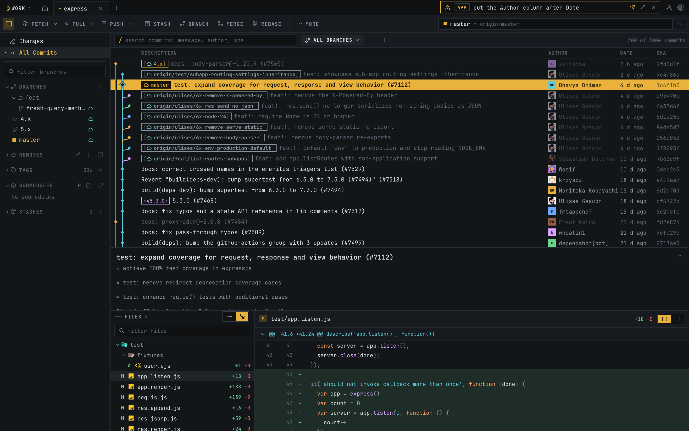

# Prong



Prong is a desktop git client in the spirit of [Fork](https://git-fork.com) that you customize by asking. It is an experiment in software that an agent changes from inside: the agent built into Prong edits Prong's own source code while the app is running.

You type what you want into the agent bar: "put the Author column after Date", "collapse Tags in the sidebar by default", "add a button that pushes to every remote". The agent changes the sources, Prong rebuilds its interface and the window reloads with the change. Every change is saved as a version that you can revert, re-apply or reset to the factory build. Over time the client becomes the one you would have written for yourself.

The same agent also does git work in the open repository: "squash my last three commits", "why was my push rejected?".

Prong is an experiment. It runs on macOS, the app is signed ad hoc (you build it yourself), and the agent is [Claude Code](https://claude.com/claude-code) on your machine.

## What it does

- **History.** A commit graph drawn as one layer. Merges fold and unfold. You can filter branches (all, current or selected) and search by message, author or SHA. Each commit has a menu: checkout, branch, tag, cherry-pick, revert, reset, rebase and interactive rebase.
- **Changes.**
  - Tree or list view.
  - Stage and unstage a file, a hunk or single lines; discard.
  - Resolve conflicts with ours / base / theirs.
  - Commit, amend, or commit and push.
  - Submodules whose own files changed are listed, as in Fork.
- **Diffs.**
  - Unified or split, with syntax highlighting.
  - Images before and after; audio and video players.
  - Binary files, renames and submodule pointers.
- **Everyday git.**
  - Fetch, pull and push with progress.
  - Stashes, branches, tags, remotes.
  - Submodules: update, sync, open.
  - Blame, file history, undo.
- **Accounts.**
  - GitHub sign-in (Device Flow or a token); clone from your repository list.
  - SSH keys: generate, add to ssh-agent, upload to GitHub.
  - A connection (SSH key or account) per repository.
  - Secrets are kept in the macOS Keychain.
- **Workspaces.** Separate sets of repositories (for example `@work` and `@home`), each with its own tabs, filled by scanning a root folder.
- **Agent.**
  - ⌘J opens the agent bar. The full panel has a Markdown chat, the version log and the settings.
  - A failed git command offers **Ask AI**, which sends the error and git's output to the agent.
- **Look.**
  - A monospace terminal style in five colour schemes, light and dark.
  - Interface scale from 80 to 150 %.
  - A command palette (⌘K) and keyboard shortcuts (⌘/).

Prong stays fast on large repositories. It was profiled on a repository with 480 thousand commits, 20 submodules and a 50 GB `.git`. That repository opens in about a second, and `git status` takes 0.25 s instead of 18 s. See [docs/PERFORMANCE.md](docs/PERFORMANCE.md).

## How it works inside

```
Prong.app ── Swift shell (AppKit + WKWebView)
 │
 ├─ window ──────── the interface: Expo / React Native, rendered with react-native-web
 │                    │  HTTP + server-sent events on 127.0.0.1
 ├─ child process ── the engine: Node + TypeScript
 │                    ├─ runs the system git and parses its porcelain output
 │                    ├─ one action queue per repository, caches for big histories
 │                    ├─ serves the interface build: the factory one or the agent's latest
 │                    └─ runs the agent: the Claude Code CLI
 └─ bridge ──────── native services: folder picker, Reveal in Finder, Open in Terminal
```

**The interface** (`App.tsx`, `src/`) uses Expo SDK 58, React Native 0.88 and TypeScript. It draws in the window through react-native-web, and the graph and icons through react-native-svg; there is no UI kit.
- State lives in one store on `useSyncExternalStore` (`src/state/store.ts`).
- `src/state/live.ts` turns each action into a call to the engine, then reads the repository again.
- The engine's API is described in `src/git/GitClient.ts`.

**The engine** (`server/`) runs the system `git` in a non-interactive environment and parses what it prints (`server/src/git/{run,parse,repo}.ts`). It answers over HTTP and streams the progress of long operations (`server/src/api.ts`).
- Changes to a repository go through its queue one at a time and wait until other git processes release their locks. Reads run in parallel.
- On large repositories the engine:
  - turns on git's fsmonitor and untracked cache;
  - caches the log, keyed by the state of the refs;
  - reads submodules side by side.

**The shell** (`macos/`) is a small Swift app that shows the web build in a WKWebView.
- It starts the engine on a free port from 8790, using a portable Node inside the bundle.
- It waits for `/api/health`, then loads the interface that the engine serves.
- Native services go through `window.webkit.messageHandlers.prong` (`src/desktop.ts`).

### How the agent changes Prong

1. **A request and a target.** The agent bar sends a request to the open repository (`repo`), to Prong itself (`app`), or picks one by the request's words (`auto`). If the agent decides a request belongs to the other target, it replies `PRONG_TARGET: app` (or `repo`), and Prong runs the request there.
2. **The run.** The engine starts `claude -p` in the folder of Prong's sources (`server/src/agent.ts`).
   - The system prompt maps the code: where the toolbar, sidebar, store and theme are.
   - The allowed tools are reading, editing and searching files, `git`, `npx tsc` and `npm test`.
   - Repository requests run in the repository's folder, with git and read-only tools only.
   - The steps appear in the agent bar as they happen: "Reading store.ts", "Type-checking".
3. **A version** (`server/src/appsources.ts`).
   - Before the run, the engine notes which source files already differ.
   - After the run, the files the agent changed become one commit, `agent: <request>`. Edits you had in progress stay out of it.
   - In a clone of this repository, the commit goes into the clone.
   - If the sources folder is not a git repository of its own (for example, it sits inside a larger checkout), Prong keeps a shadow repository in `~/.prong/app-sources/<hash>.git` with the folder as its work tree. No `.git` is added to the folder.
4. **A new interface.**
   - The engine runs `expo export` on the sources into `~/.prong/ui/builds/<stamp>`.
   - It points `~/.prong/ui/current` at the new build and serves it instead of the factory build.
   - It sends `ui-updated`, and every window reloads with its tabs, chat and notices kept.
5. **Safety.**
   - A build that fails is never served. With the setting on, its change is rolled back.
   - **Revert** and **Re-apply** run `git revert` on one version.
   - **Roll back here** and **Reset to factory** revert every later version. The log is kept, so any version can be applied again.
   - Without an agent build, the app serves the build it shipped with.

Prong is a git client, so you can open its sources folder in Prong itself: the agent's versions are ordinary commits with ordinary diffs.

## Run it

```bash
npm install && (cd server && npm install)
npm run server        # the engine on http://127.0.0.1:8790 (needs git)
npm run web           # the interface on http://localhost:8081
```

The macOS app:

```bash
macos/fetch-node.sh   # once: a portable Node 22 in macos/vendor
macos/build.sh --run  # builds macos/build/Prong.app and opens it
```

Setting up the agent:
1. Install Claude Code and sign in; `claude --version` must work.
2. Point Prong at its sources in **Agent → Settings → Sources folder**. An engine started from a checkout with `npm run server` uses that checkout by default.
3. Run `npm install` in that folder: the engine builds the interface with the folder's own Expo.

Claude Code is the only provider that works so far. The other choices in the settings are placeholders.

## Tests

```bash
npm test              # app unit tests (vitest)
npm run server:test   # engine tests on real temporary repositories
npm run e2e           # headless Chromium against a real engine, all suites
npm run test:affected # only what a change touches
```

The end-to-end suites start their own engine with a temporary state folder and their own fixture repositories, so `~/.prong` and your repositories are never touched. In these tests the agent is a stand-in script, `tools/fake-claude.sh`: no network and no cost.

## More

These documents are in Russian:

- [docs/DESIGN.md](docs/DESIGN.md): the functional design and a log of the decisions behind it.
- [docs/TEST-PLAN.md](docs/TEST-PLAN.md): the test cases.
- [docs/PERFORMANCE.md](docs/PERFORMANCE.md): profiling on a large repository.
- [docs/DESIGN-STYLES.md](docs/DESIGN-STYLES.md): the ten visual directions that were considered; the mock-ups are in [docs/design-styles.html](docs/design-styles.html).
- [docs/DEVELOPMENT.ru.md](docs/DEVELOPMENT.ru.md): the previous README, covering setup, project structure, screenshot scripts and test commands.

File and folder icons come from [Material Icon Theme](https://github.com/material-extensions/vscode-material-icon-theme) (MIT; the license is in `public/file-icons/LICENSE.txt`).
